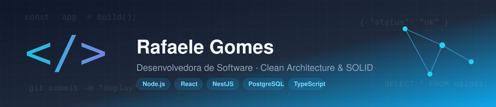

# Maria Rafaele Gomes de Araújo

Desenvolvedora de software, cursando Análise e Desenvolvimento de Sistemas (UNIFOR). Desenvolvo sistemas web sob medida — do levantamento de requisitos à entrega em produção — com foco em arquitetura organizada e manutenível.

## Tecnologias

**Frontend** — TypeScript, React, Next.js, Tailwind CSS
**Backend** — Node.js, NestJS, Fastify, Zod
**Banco de dados** — PostgreSQL, Prisma, Supabase
**IA** — Integração com LLMs (Anthropic Claude), prompt engineering, RAG, agentes especializados
**Outras** — Git, testes automatizados (Vitest, Playwright)

## Como trabalho

Organizo os projetos em camadas (domínio, aplicação, infraestrutura), aplicando princípios de SOLID e Clean/Hexagonal Architecture para manter as regras de negócio independentes de framework e banco de dados. Em sistemas que lidam com dados de usuário, isso inclui tratar segurança e conformidade com a LGPD como parte do design — por exemplo, implementando anonimização de dados que preserva a integridade referencial e a trilha de auditoria.

## Projetos selecionados

**[CorreDelas](https://github.com/RafaeleGomes-dev/CorreDelas)** — plataforma social de segurança para corredoras, com cadastro/autenticação, registro de atividades físicas e metas de progresso. Monólito modular em Clean Architecture (Node.js/Fastify + React), PostgreSQL via Prisma.

**[docfacil](https://github.com/RafaeleGomes-dev/docfacil)** — SaaS de geração de documentos em PDF a partir de formulários dinâmicos, com conta de usuário, cobrança (Mercado Pago) e painel administrativo. Next.js (App Router) + PostgreSQL/Prisma.

**[Oficina Santo Expedito](https://github.com/RafaeleGomes-dev/Oficina-santo-expedito)** — sistema de gestão de estoque, vendas e equipe para pequeno comércio, com controle de acesso por perfil (administrador/estoquista/atendente) e auditoria. Em uso real. React + Vercel Functions + PostgreSQL.

**PrevLex** *(projeto confidencial)* — plataforma de geração assistida por IA de petições jurídicas previdenciárias, com banco de teses por escritório, múltiplos agentes especializados (triagem, pesquisa, redação, revisão) e RAG sobre uma base de jurisprudência própria.

**Sistema interno de comunicação corporativa** *(projeto confidencial)* — gestão de demandas entre setores com SLA e chat corporativo em tempo real. Backend em NestJS/Clean Architecture, autorização por papel e escopo organizacional, WebSocket para notificações, e conformidade com a LGPD (anonimização de dados de usuário).

**Sistema de acompanhamento operacional de usinas de energia solar** *(projeto confidencial)* — consolida e confere dados mensais de geração, consumo e faturamento por usina, com motor de detecção de divergência e fluxo de aprovação para alteração de dados já fechados. NestJS/Clean Architecture, PostgreSQL/Prisma, autenticação com MFA e RBAC.

**Sistema de controle de desconto por unidade consumidora** *(projeto confidencial)* — substitui um controle feito em planilha por importação validada e auditável de percentuais de desconto por cliente, com motor de precedência de regras e trilha de auditoria completa. NestJS/Clean Architecture, PostgreSQL/Prisma.

**Rede social privada para evento** *(projeto pessoal)* — aplicação de acesso restrito por convite, com feed, chat em tempo real e álbum de fotos. React + Supabase (autenticação, Postgres, Realtime, Storage, Row Level Security), PWA.

## Contato

Sistemas sob medida: [rafaele-sistemas.vercel.app](https://rafaele-sistemas.vercel.app)
E-mail: contato.rafaeleprojects@gmail.com
